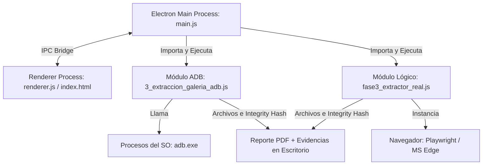

# 🚀 Guía de Funcionamiento y Migración: App Electron
Este documento detalla el funcionamiento interno de la aplicación de escritorio **Forensic Data Extractor Suite** construida con **Electron**, explicando cómo se comunican las interfaces visuales (Renderer) con el motor de extracción de bajo nivel (Main Process), cómo ejecutarla y cómo asegurar que funcione de manera óptima y reproducible en producción.

---

## 🏗️ 1. Arquitectura de Procesos en Electron
La suite forense emplea un modelo de **dos procesos separados**, que garantiza la estabilidad del software frente a operaciones pesadas de red y disco (como escaneos ADB o scrolls infinitos en WhatsApp).



### A. Proceso Principal (Main Process - `main.js`)
*   **Responsabilidad:** Controla el ciclo de vida de la aplicación, crea la ventana visual nativa (`BrowserWindow`) y posee privilegios de sistema completo (Node.js completo, acceso a disco, ejecución de comandos y subprocesos como `adb.exe`).
*   **Orquestación:** Recibe peticiones de la interfaz vía IPC (Inter-Process Communication) y ejecuta los módulos forenses de forma asíncrona.

### B. Proceso de Renderizado (Renderer Process - `renderer.js` / `index.html`)
*   **Responsabilidad:** Renderiza la interfaz visual interactiva basada en una estética moderna de "Panel Ciberforense" (Glassmorphism, Modo Oscuro profundo).
*   **Interacción:** Captura las acciones del analista (clicks en botones, inputs de texto, selección de checkboxes), envía señales de ejecución al Main Process y escucha en tiempo real los eventos de log que ocurren tras bambalinas para pintarlos en la terminal integrada.

---

## 🔌 2. Sistema de Comunicación IPC (Paso a Paso)

La integración y control en tiempo real entre la UI y los scripts se realiza a través de tres canales de comunicación IPC principales:

### Canal `get-wa-contacts` (Carga de Conversaciones)
1. **Renderer:** Al presionar "Leer Chats Recientes", `renderer.js` envía `ipcRenderer.send('get-wa-contacts')`.
2. **Main:** `main.js` captura el evento, abre Playwright en segundo plano y ejecuta `getWhatsAppContacts()`.
3. **Módulo Lógico:** Playwright inicia Edge, navega a WhatsApp Web, espera que el usuario esté conectado, recopila la lista de contactos recientes y la retorna a `main.js`.
4. **Main:** Responde al Renderer enviando la lista vía `event.reply('wa-contacts-result', contacts)`.
5. **Renderer:** Oculta el spinner de carga y genera dinámicamente la tabla HTML con checkboxes para que el usuario elija qué conversaciones extraer.

### Canal `start-whatsapp` (Extracción Lógica)
1. **Renderer:** Al seleccionar contactos y hacer click en "Iniciar Extracción Lógica", recopila los nombres y el estado de `testMode` y envía `ipcRenderer.send('start-whatsapp', data)`.
2. **Main:** `main.js` invoca a `runWhatsAppExtraction({testMode, contactos}, uiLogger)`.
3. **Módulo Lógico:** Levanta el navegador, busca contacto por contacto, realiza scrolls inversos (con control inteligente de scroll e iteraciones limitadas en modo test), extrae el texto nativo con selectores DOM (`data-pre-plain-text`), genera el archivo `.csv`, computa el hash SHA-256 en tiempo real y compila el certificado forense en PDF (`pdfkit`).
4. **Logs en Caliente:** Durante todo el proceso, `uiLogger` manda logs de progreso que el Main reenvía al Renderer usando `event.reply('wa-terminal-log', mensaje)`.

### Canal `start-adb` (Extracción Física)
1. **Renderer:** Captura el método de conexión (USB, WiFi con IP y Puerto) y el estado de `testMode`, y envía `ipcRenderer.send('start-adb', data)`.
2. **Main:** Invoca a `runADBExtraction({testMode, metodo, connectIpPort}, uiLogger)`.
3. **Módulo ADB:** Verifica y empareja (en WiFi nuevo) el dispositivo, se conecta a través del binario local `adb.exe`, ejecuta `pull` recursivos de las carpetas `/sdcard/DCIM/`, `/sdcard/Pictures/`, etc., descarga los archivos a la ruta local, calcula la firma SHA-256 de cada recurso extraído y genera el Certificado Forense PDF.
4. **Logs en Caliente:** Envía logs en tiempo real vía `event.reply('terminal-log', mensaje)` para mostrar las fotos descargadas y el estado del hash.

---

## ⚙️ 3. Configuración para Desarrollo y Empaquetado

### Requisitos del Entorno
*   **Node.js:** Versión 16 o superior.
*   **Dependencias principales (`package.json`):**
    *   `electron`: ^41.5.0 (Gestión de la ventana y APIs nativas).
    *   `playwright`: ^1.59.1 (Motor lógico del navegador).
    *   `pdfkit`: ^0.18.0 (Generador criptográfico forense de reportes en PDF).

### Comando de Desarrollo
Para arrancar el entorno interactivo de desarrollo local:
```bash
npm start
```

### Empaquetado para Distribución (.EXE)
El proyecto utiliza `electron-builder` configurado para compilar un instalador nativo de Windows (NSIS) de 64 bits.

1. **Estructura Crítica (`extraResources`):**
   En `package.json`, se encuentra configurada la sección:
   ```json
   "extraResources": [
     {
       "from": "bin",
       "to": "bin"
     }
   ]
   ```
   **IMPORTANTE:** Para que la suite funcione de forma 100% independiente en la máquina del cliente final (sin requerir que instale Android Studio), debes incluir el ejecutable de `adb.exe` y sus librerías asociadas (`AdbWinApi.dll`, `AdbWinUsbApi.dll`) en una carpeta llamada `bin` en la raíz del proyecto.
   
2. **Ejecutar la compilación:**
   ```bash
   npm run build
   ```
   Esto generará un instalador autoejecutable en la carpeta `dist/` llamado `Forensic Data Extractor Suite Setup.exe`.

---

## 🛡️ 4. Aseguramiento y Garantía de Funcionamiento
Para garantizar que el software funcione sin fallos y mantenga un comportamiento predecible en las operaciones forenses:

1. **Uso de Test Mode:** Utiliza siempre el toggle de **Test Mode** (activado por defecto) en las pestañas de ADB y WhatsApp. Esto limitará la auditoría a 2 contactos, 2 scrolls y máximo 2 descargas de fotos, permitiendo comprobar que los navegadores abren, que ADB tiene conectividad y que los PDFs se compilan en milisegundos.
2. **Ubicación de Salida:** Las evidencias se guardan localmente en el Escritorio del usuario en:
   *   `C:\Users\<Usuario>\Desktop\Forensic_Extractions\Auditoria_WhatsApp`
   *   `C:\Users\<Usuario>\Desktop\Forensic_Extractions\Extraccion_Fisica_ADB`
   Asegúrate de que la aplicación tenga permisos de escritura en la carpeta del Escritorio.
3. **Manejo de Sesión de Navegador:** La sesión de WhatsApp Web se guarda en un perfil persistente local en `C:\Users\<Usuario>\.forensic_whatsapp_session` para evitar tener que escanear el código QR cada vez. Si por alguna razón la sesión se corrompe, simplemente borra este directorio para forzar un logueo nuevo y limpio.
